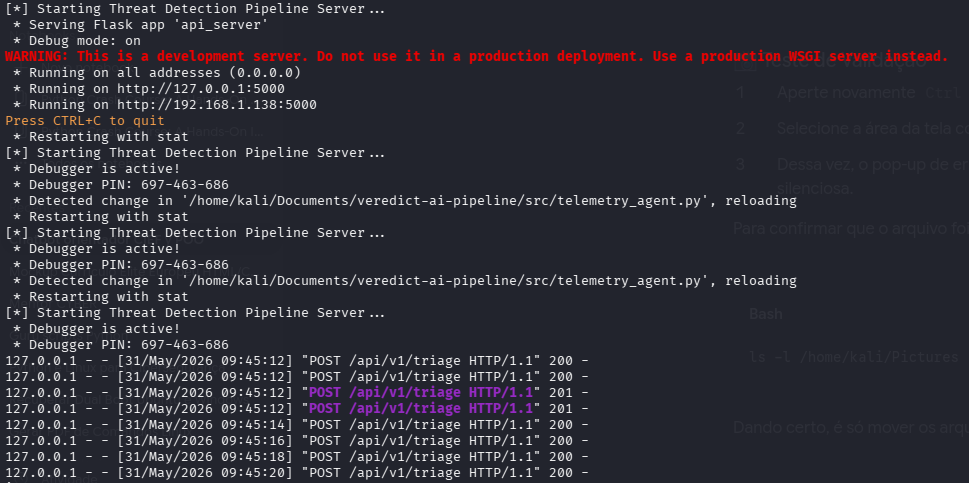
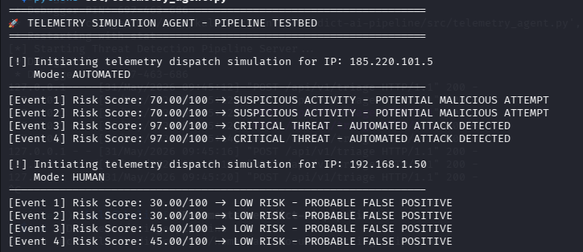

# Triage Pipeline – Análisis de Telemetría Basado en Comportamiento para Operaciones de SOC

Triage Pipeline es un laboratorio de ciberseguridad defensiva enfocado en el análisis de telemetría de seguridad y el triaje automatizado de eventos. 

El proyecto simula un flujo de trabajo real de un SOC mediante el procesamiento de eventos de autenticación a través de una API REST y la aplicación de técnicas de análisis de comportamiento para diferenciar la actividad de usuarios legítimos de posibles ataques automatizados. En lugar de depender exclusivamente de umbrales estáticos o detección basada en firmas, el sistema evalúa los patrones temporales entre eventos para identificar comportamientos sospechosos y reducir el ruido de las alertas.

---



## 🎯 Objetivos

Este laboratorio fue creado para demostrar habilidades prácticas en:
* **Desarrollo en Python** (Prácticas de Clean Code y uso de la librería estándar)
* **Diseño de APIs REST** con Flask
* **Procesamiento e Ingesta de Telemetría** de Seguridad
* **Análisis de Comportamiento** y Entropía Temporal
* **Entornos Linux** (Despliegue y ejecución)
* **Automatización de Seguridad** (Análisis de logs y puntuación reactiva)
* **Generación de Evidencias en JSON** para ingesta posterior
* **Mapeo con la Matriz MITRE ATT&CK**

---

## 🏛️ Arquitectura

La solución está compuesta por dos componentes principales:

### 1. Servidor API (`src/api_server.py`)
El microservicio central responsable de:
* Recibir eventos de telemetría en bruto a través de HTTP POST.
* Procesar intentos de autenticación de forma dinámica.
* Calcular puntuaciones de riesgo conductual utilizando principios estadísticos.
* Generar hallazgos de seguridad estructurados en formato JSON.

### 2. Agente de Telemetría (`src/telemetry_agent.py`)
Un cliente ligero utilizado para simular eventos de seguridad y validar la lógica de detección. El agente genera dos escenarios operacionales:
* **Actividad Automatizada:** Perfil de comportamiento de una herramienta de fuerza bruta.
* **Actividad Humana:** Fallos de autenticación de usuarios legítimos (errores de escritura/retraso orgánico).

---



## 🧠 Lógica de Detección

El motor de detección analiza el tiempo exacto entre intentos de autenticación consecutivos para detectar la predictibilidad.

### Actividad Automatizada
Los scripts y las herramientas de fuerza bruta automatizadas suelen generar solicitudes en intervalos matemáticamente idénticos.
* **Ejemplo de cadencia:** `1.0s` ➔ `1.0s` ➔ `1.0s` ➔ `1.0s`
* **Resultado:** Este comportamiento produce una varianza temporal cercana a cero, lo que indica una alta probabilidad de automatización y eleva la puntuación de riesgo.

### Actividad Humana
Las interacciones humanas tienden a ser irregulares y variables debido a limitaciones físicas y retrasos cognitivos.
* **Ejemplo de cadencia:** `2.1s` ➔ `4.8s` ➔ `1.9s` ➔ `3.7s`
* **Resultado:** Este comportamiento genera una mayor varianza temporal y el motor lo clasifica como un error de usuario de bajo riesgo.

---

## 📊 Clasificación de Riesgo

El motor procesa los datos temporales y asigna una puntuación de riesgo dinámica que va de `0` a `100`.

| Rango de Puntuación | Clasificación | Descripción / Acción |
| :--- | :--- | :--- |
| **0 – 39** | `LOW RISK` | Probable error humano o falso positivo. No se genera alerta. |
| **40 – 69** | `MEDIUM RISK` | Actividad sospechosa. Requiere monitorización continua. |
| **70 – 100** | `HIGH RISK` | Alta probabilidad de ataque automatizado. Activa la respuesta de mitigación. |

---

## 🛡️ Mapeo MITRE ATT&CK

* **Táctica:** Credential Access
* **Técnica:** [T1110 – Brute Force](https://attack.mitre.org/techniques/T1110/)

---

## 📋 Ejemplo de Salida (Telemetría JSON)

```json
{
  "timestamp": "2026-05-31T18:45:12Z",
  "source_ip": "185.220.101.5",
  "risk_score": 97.00,
  "classification": "HIGH_RISK",
  "mitre_technique": "T1110",
  "description": "CRITICAL THREAT - AUTOMATED ATTACK DETECTED"
}


triage-pipeline/
├── .venv/                 # Entorno virtual aislado de Python (PEP 668)
├── assets/                # Capturas de pantalla de validación operacional
├── src/
│   ├── api_server.py      # Servidor API REST y Motor de IA Analítica
│   └── telemetry_agent.py # Agente de simulación de producción y despacho de telemetría
├── .gitignore             # Reglas de protección para entornos locales y caché
└── README.md              # Documentación técnica y ejecutiva híbrida (IA + FinOps)


